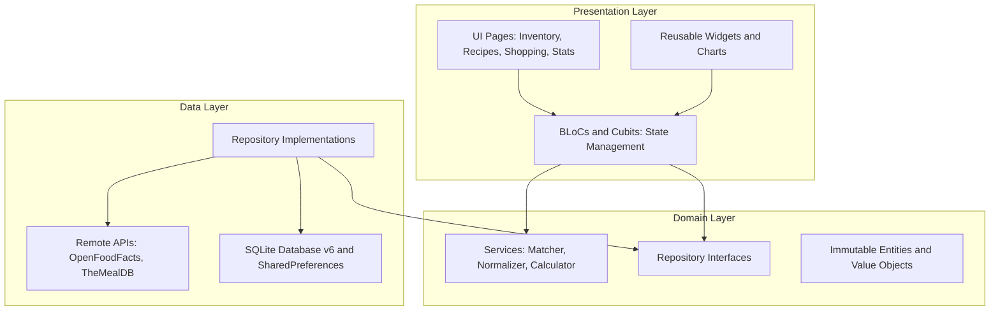
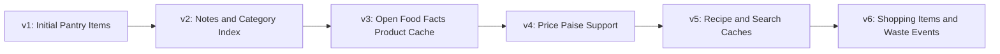

# Pantry Pal 🥑📦

[](https://flutter.dev)
[](https://dart.dev)
[](https://opensource.org/licenses/MIT)
[]()
[]()
[]()

> **Pantry Pal** is a local-first mobile pantry management, grocery tracking, and kitchen waste reduction assistant built with **Flutter**, **BLoC/Cubit**, and **Clean Architecture**. It helps households effortlessly monitor food expiry dates, digitize paper receipts using on-device ML OCR, look up barcodes, discover recipes matching pantry ingredients, and track food waste savings.

---

## 📖 Table of Contents

- [Why Pantry Pal?](#-why-pantry-pal)
- [Key Features](#-key-features)
- [Architecture & Design](#-architecture--design)
- [Tech Stack & Dependencies](#-tech-stack--dependencies)
- [Security & Privacy by Design](#-security--privacy-by-design)
- [Database Schema & Migrations](#-database-schema--migrations)
- [Project Structure](#-project-structure)
- [Getting Started](#-getting-started)
- [Testing & Quality Assurance](#-testing--quality-assurance)
- [Release Builds](#-release-builds)
- [License](#-license)

---

## 💡 Why Pantry Pal?

Every year, the average household throws away hundreds of kilograms of food simply because items get lost at the back of refrigerators or pantry shelves until long after their expiry dates.

**Pantry Pal** solves this with an intentional, zero-friction workflow:
1. **Effortless Input**: Add items manually with smart shelf-life defaults, scan barcodes via Open Food Facts, or snap a photo of paper supermarket receipts for instant batch OCR digitization.
2. **Never Forget**: Daily local notifications alert you *before* groceries go bad, with customizable lead times and notification hours.
3. **Cook What You Have**: A recipe recommendation engine searches meals based on available ingredients and lets you export missing items directly to your shopping list.
4. **Quantify Your Impact**: Detailed waste statistics visualize units rescued vs. wasted, rupees saved, and days since last waste.

---

## ✨ Key Features

### 1. 🗄️ Smart Pantry & Expiry Tracking
- **Color-Coded Expiry Urgency**: Real-time visual status badges (Fresh, Expiring Soon ≤ 3 days, and Expired).
- **Fast Search & Category Filtering**: Instant debounce search across names and notes, with filters for Produce, Dairy, Bakery, Meat, Grains, Snacks, and more.
- **Smart Shelf-Life Suggestions**: Selecting a category automatically suggests realistic shelf lives based on food science defaults.
- **Optimistic Swipe Actions**:
  - **Swipe Right (Used up)**: Consumes one unit. If quantity hits 0, it removes the item and automatically adds it to your shopping list with a quick **Undo** SnackBar.
  - **Swipe Left (Delete)**: Removes entries entered by mistake (excluded from waste statistics).
  - **Mark Wasted**: Logs discarded food with date, category, and rupee value for analytics.

### 2. 🧾 On-Device OCR Receipt Scanning
- **Privacy-Preserving Optical Character Recognition**: Powered by Google ML Kit text recognition running completely offline on your device.
- **Heuristic Parsing Engine**: Automatically separates item lines from totals, tax rows, dates, and discounts, parsing item names, quantities, and prices in Indian Rupees (₹).
- **Batch Review & Merge**:
  - Review recognized grocery rows before saving.
  - Automatically identifies duplicates already in your pantry, allowing you to either increment existing stock or add separate entries.
  - Atomic batch insert via a single SQLite database transaction.

### 3. 🔍 Barcode Scanner & Open Food Facts Integration
- **Rapid Camera Scanner**: Built on `mobile_scanner` with torch control and smooth target overlay.
- **Product Metadata**: Fetches food title, brand, packaging, and automatic category mapping from the public Open Food Facts API.
- **Offline Product Cache**: Looked-up items are cached in SQLite so repeated scans work with zero network latency.

### 4. 🍳 Recipe Matching Engine & Missing Ingredient Sync
- **Cook With What You Have**: Connects with TheMealDB culinary database to find recipes matching your available pantry items.
- **Intelligent Ingredient Normalizer**: Removes noise words (e.g., "chopped", "fresh", "organic"), strips brand names, and maps culinary synonyms (e.g., "curd" ↔ "yogurt").
- **Real-Time Match Score**: Shows exact match percentages (e.g., "You have 5 of 6 ingredients").
- **Kitchen Staples Intelligence**: Common staples (salt, pepper, cooking oil, water) are recognized and excluded from missing counts unless marked unavailable.
- **One-Tap Shopping List Sync**: Tap *"Add missing ingredients to shopping list"* to send missing recipe requirements directly into your shopping queue.
- **Strict Vegetarian Filter**: Optional toggle that excludes meat, poultry, seafood, and animal broth recipes.

### 5. 🛒 Smart Shopping List
- **Three Ways to Populate**:
  1. Quick-add bar with category selector.
  2. Automatic re-order when pantry items are consumed to zero.
  3. One-tap export from recipe detail pages.
- **Grouped Categories**: Categorizes your groceries so you can navigate aisles efficiently.
- **Pantry Duplicate Warning**: Alerts you if you try to add an item you already have in stock.
- **Bought Archive**: Ticking items moves them to a completed section with a *"Clear bought items"* action and full Undo support.

### 6. 📊 Waste Statistics & Visual Analytics
- **Summary Metrics**: Units rescued, units wasted, waste percentage rate, value used vs. wasted (in ₹), and **Days Since Last Waste**.
- **Visual Charts** (via `fl_chart`):
  - **Used vs. Wasted Bar Chart**: Compares quantities consumed on time vs. spoiled across selected time periods.
  - **Category Waste Donut Chart**: Highlights which food categories contribute most to household waste.
- **Time Periods**: Filter insights across Last 7 Days, Last 30 Days, Last 90 Days, or All Time.
- **Normalized Top Wasted Items**: Highlights frequently wasted items with intelligent synonym aggregation.

### 7. 🔔 Scheduled Local Expiry Notifications
- **100% Offline Alerts**: Built with `flutter_local_notifications` without any background servers.
- **Customizable Preferences**: Configure your preferred notification hour (e.g. 9:00 AM) and lead warning days (1, 2, 3, or 7 days prior).
- **Device Reboot Resilience**: Boot receiver re-schedules notifications automatically upon device restart.

### 8. 🛡️ Data Ownership, Backup & Settings
- **JSON Data Export**: Export a complete JSON backup of all pantry items, shopping list items, and waste event logs via the native OS share sheet.
- **Secure Destruction**: Two-step double confirmation dialog to completely wipe all tables and local caches.
- **Polite Onboarding**: 4-slide walkthrough explaining key benefits and polite explanation of notification permissions before asking for system access.

---

## 🏛️ Architecture & Design

Pantry Pal strictly adheres to **Clean Architecture** and the **BLoC (Business Logic Component)** pattern, ensuring strict separation of concerns, testability, and maintainability.



### Architectural Principles
- **Stateless Widgets by Default**: All UI components are `StatelessWidget`. State is only retained in BLoCs and Cubits (or isolated controller lifecycles like camera feed controllers).
- **Immutable State with Equatable**: All models and UI states are immutable, preventing accidental side effects and enabling predictable state transitions.
- **Interface-Driven Repositories**: BLoCs depend strictly on abstract repository contracts, enabling comprehensive unit testing with `mocktail` without database I/O.
- **Single Source of Truth**: SQLite acts as the single persistent source of truth. UI actions trigger optimistic updates followed by atomic SQLite transactions.

---

## 🛠️ Tech Stack & Dependencies

| Category | Technology | Usage |
| :--- | :--- | :--- |
| **Framework** | Flutter 3.x / Dart 3.x | Cross-platform UI toolkit |
| **State Management** | `flutter_bloc: ^9.1.1` | Predictable event-driven state |
| **Routing** | `go_router: ^14.8.1` | Declarative, deep-link capable URL router |
| **Local Database** | `sqflite: ^2.4.2` | Native SQLite engine with schema migrations |
| **HTTP Client** | `dio: ^5.8.0+1` | Robust networking with timeouts & interceptors |
| **Computer Vision** | `google_mlkit_text_recognition: ^0.15.0` | On-device ML receipt OCR |
| **Barcode Scanner** | `mobile_scanner: ^6.0.7` | Hardware camera barcode scanning |
| **Charts** | `fl_chart: ^1.1.1` | Interactive donut and bar charts |
| **Notifications** | `flutter_local_notifications: ^18.0.1` | Local scheduled alarm notifications |
| **Native Splash** | `flutter_native_splash: ^2.4.8` | Android 12+ and iOS launch splash screens |
| **Icons** | `flutter_launcher_icons: ^0.14.4` | Adaptive app launcher icons |
| **Sharing** | `share_plus: ^10.1.4` | Native share sheet for JSON backups |
| **Equality & Date** | `equatable`, `intl` | Value equality and Indian Rupee / date formatting |

---

## 🔒 Security & Privacy by Design

- **100% Local-First**: No remote database, no user accounts, no telemetry, and zero tracking SDKs. Your grocery receipts, inventory, and spending data never leave your phone.
- **Backup Leakage Prevention**: Android ADB backup is explicitly disabled (`android:allowBackup="false"` in `AndroidManifest.xml`), protecting your SQLite database from unauthorized extraction via USB debugging.
- **Strict HTTPS Only**: Cleartext unencrypted traffic is blocked on both platforms (`android:usesCleartextTraffic="false"` and iOS `NSAllowsArbitraryLoads = false`).
- **Input Sanitization**: Barcode strings and text inputs are length-capped and validated against injection tokens before making HTTP requests.
- **API Key Segregation**: API keys and external endpoints are isolated in a gitignored configuration file ([`lib/core/config/api_keys.dart`](file:///Users/hadiya/develop/projects/pantry_pal/lib/core/config/api_keys.dart)), with an environment-based override (`--dart-define`).
- **SQL Injection Immune**: All SQLite database interactions use parameterized queries (`whereArgs`) and escaped wildcard matchers.

---

## 🗄️ Database Schema & Migrations

The SQLite database (`pantry_pal.db`) is managed via [`AppDatabase`](file:///Users/hadiya/develop/projects/pantry_pal/lib/core/database/app_database.dart) with full incremental schema upgrades tested from version 1 through version 6:



---

## 📂 Project Structure

```
lib/
├── core/
│   ├── config/              # Gitignored API keys and configuration templates
│   ├── database/            # SQLite AppDatabase & incremental schema migrations
│   ├── errors/              # Global error boundary and friendly fallback screens
│   ├── router/              # GoRouter route declarations & parameters
│   └── theme/               # ColorScheme, typography, and Material 3 theme data
├── features/
│   ├── inventory/           # Pantry items list, search, filter, form & edit cubits
│   ├── notifications/       # Expiry notification planner, settings & sync service
│   ├── onboarding/          # 4-slide introductory carousel & permission prompt
│   ├── product_lookup/      # Camera barcode scanner & Open Food Facts caching
│   ├── receipt/             # Google ML Kit OCR scanner, receipt parser & review
│   ├── recipes/             # TheMealDB remote client, normalizer, matching engine
│   ├── settings/            # Data backup export, wipe dialog & user preferences
│   ├── shopping/            # Shopping list, quick-add, auto-reorder & batch review
│   └── stats/               # Waste analytics, fl_chart widgets & insights engine
└── main.dart                # App entrypoint, dependency injection & error handlers
```

---

## 🚀 Getting Started

### Prerequisites
- [Flutter SDK](https://docs.flutter.dev/get-started/install) (`>= 3.24.0`)
- Android Studio / Xcode (with iOS Simulator / CocoaPods)
- Java 17+ / Gradle 8+

### Setup
1. **Clone the repository**:
   ```bash
   git clone https://github.com/hadiya/pantry_pal.git
   cd pantry_pal
   ```

2. **Setup API Configuration**:
   Copy the template API configuration file (gitignored):
   ```bash
   cp lib/core/config/api_keys.example.dart lib/core/config/api_keys.dart
   ```

3. **Install Dependencies**:
   ```bash
   flutter pub get
   ```

4. **Run the Application**:
   ```bash
   # Run on connected device or simulator
   flutter run
   ```

---

## 🧪 Testing & Quality Assurance

Pantry Pal maintains a comprehensive test suite across unit, cubit, widget, full-chain database migration, and end-to-end integration tests.

### Running Tests
```bash
# Run all 319 unit, cubit, and widget tests
flutter test

# Run tests with code coverage report
flutter test --coverage

# Run static analysis (strict lint rules)
flutter analyze
```

### Running the End-to-End Journey Test
An integration test verifying the full journey (**Add item → See in pantry → Mark used up → See on shopping list**) is available:
```bash
# On macOS desktop runner:
flutter test integration_test/core_journey_test.dart -d macos

# On connected Android or iOS device:
flutter test integration_test/core_journey_test.dart -d <device-id>
```

---

## 📦 Release Builds

### Android Release
Release builds have R8 full code shrinking and resource optimization enabled:

```bash
# Build Android App Bundle (Google Play Store)
flutter build appbundle --release

# Build split-per-ABI APKs for testing on real devices
flutter build apk --split-per-abi --release
```
*Outputs are located in `build/app/outputs/bundle/release/app-release.aab` and `build/app/outputs/flutter-apk/`.*

### iOS Release
1. Open `ios/Runner.xcworkspace` in Xcode.
2. Under **Signing & Capabilities**, select your development team for bundle identifier `com.hadiya.pantryPal`.
3. Select **Product > Archive** to package for TestFlight or the App Store.

---

## 📄 License

This project is licensed under the MIT License - see the [LICENSE](LICENSE) file for details.
